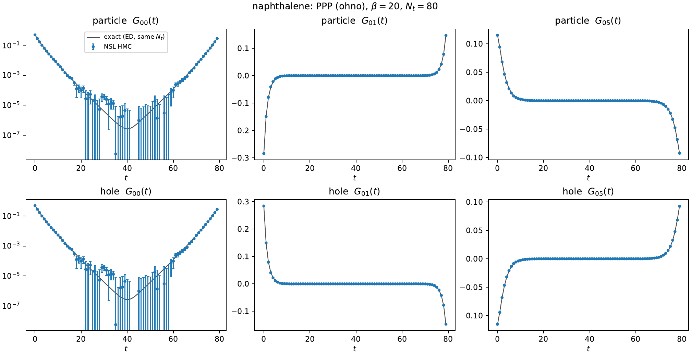

## Why ED at the same $N_t$

- HMC samples the *discretized* theory. Its propagators differ from the continuum ones by $O(\delta^2)$.
- Comparing with continuum ED would need $N_t\to\infty$ extrapolations: the test is then only as good as
  the extrapolation, and a small bug can hide in it.
- Integrating out $\phi$ slice by slice is **exact**. So NSL's ensemble averages are equal to transfer-matrix
  expectation values at the *same* $N_t$, and those can be computed exactly.
- Any disagreement beyond statistics is then a bug: in the action, the force, the integrator, the
  stabilization or the measurement.

## Integrating out the field

At fixed $\phi$, NSL's charge-basis matrices satisfy (checked numerically, next slides)

$$
\det M_p[\phi]\,\det M_h[\phi]=\operatorname{Tr}\,\prod_{t=0}^{N_t-1}\Big(e^{\delta\hat K}\,e^{\,i\phi_t\cdot\hat q}\Big)
\qquad(\text{time-ordered, } t=0 \text{ rightmost})
$$

The weight is $e^{-S_g[\phi]}\det M_p\det M_h$. Each $\phi_t$ appears in one factor only, and

$$
\int d\phi_t\;e^{-\frac12\phi_t^T(\delta V)^{-1}\phi_t}\,e^{\,i\phi_t\cdot\hat q}\;\propto\;e^{-\frac{\delta}{2}\hat q^TV\hat q}=e^{-\delta\hat H_V}
$$

$$
\Rightarrow\quad Z\propto\operatorname{Tr}W^{N_t},\qquad W=e^{\delta\hat K}\,e^{-\delta\hat H_V}
$$

No approximation is made beyond the one NSL itself makes.

## Propagators

The same argument with operator insertions gives, for $t=0,\dots,N_t-1$,

$$
\big\langle M_p^{-1}[t,0]_{xy}\big\rangle=\frac{\operatorname{Tr}\big[W^{N_t-t}\,c_{x\uparrow}\,W^{t}\,c^\dagger_{y\uparrow}\big]}{\operatorname{Tr}W^{N_t}},
\qquad
\big\langle M_h^{-1}[t,0]_{xy}\big\rangle=\frac{\operatorname{Tr}\big[W^{N_t-t}\,c^\dagger_{x\downarrow}\,W^{t}\,c_{y\downarrow}\big]}{\operatorname{Tr}W^{N_t}}
$$

- Particles ↔ spin up; holes ↔ spin down, particle–hole transformed.
- Conventions mirror `HubbardExp`:
  $M[t,t]=1$, $M[t,t-1]=-B_t\,e^{s\delta K}\operatorname{diag}(e^{is\phi_{t-1}})$, $B_0=-1$ (antiperiodic),
  $s=+1$ particles, $s=-1$ holes.
- NSL measures $M^{-1}[(t+t_s)\bmod N_t,\,t_s]$ for several sources $t_s$; averaging them with the
  antiperiodic sign gives the same $\langle M^{-1}[t,0]\rangle$.
- The continuum propagators ($e^{-\tau H}$) are also available (`--continuum`, dense backend).

## Self-test: `python ppp_ed.py --self-test`

1. **Fixed-field mapping.** 3 sites, **non-bipartite** on purpose (no symmetry can hide a sign error),
   $N_t=4$, random $\phi$. Full $2^6$-state Fock space. Compares $\det M_p\det M_h$ with the trace, and every
   entry of $M_p^{-1}$, $M_h^{-1}$ with the trace formula of the previous slide.
   **Max error $7\cdot10^{-16}$.**
2. **Backends.** Dense vs low-lying on a 4-site PPP ring ($\beta=6$, $N_t=24$). **Max error $6\cdot10^{-16}$.**
3. **Trotter check.** Lattice vs continuum propagators at $N_t=8\to16$: error ratio **3.8** ($O(\delta^2)$
   expects 4). This shows the lattice and continuum results really differ, which is why the same-$N_t$
   comparison matters.

`ppp_ed.py` builds the fermion matrix with `fermion_matrix(K, phi, delta, species)`, a line-by-line copy of
NSL's `HubbardExp` conventions, so the mapping is tested against NSL's definition, not against my reading
of it.

## Implementation: sectors and Kronecker structure

- $H$ conserves $N_\uparrow$ and $N_\downarrow$: work in sectors $(a,b)$ with basis
  $\lvert I_\uparrow,J_\downarrow\rangle=c^\dagger_{I\uparrow}c^\dagger_{J\downarrow}\lvert0\rangle$.
- $e^{\delta\hat K}=E_a\otimes E_b$: the two spin species decouple, and the hopping is bilinear, so no
  fermion sign appears between them.
- $e^{-\delta\hat H_V}=D$ is diagonal in the occupation basis.
- $W=(E_a\otimes E_b)\,D$ is not symmetric, but
$$
S=D^{1/2}(E_a\otimes E_b)D^{1/2}=D^{1/2}\,W\,D^{-1/2}
$$
  is symmetric positive definite, with the same eigenvalues → `eigh` or Lanczos.
- Matrix-free product, with $v$ stored as a $(\dim_a\times\dim_b)$ array:
  $Sv=D^{1/2}\odot\big(E_a\,(D^{1/2}\odot v)\,E_b^T\big)$.
  The 63,504 × 63,504 half-filling matrix of naphthalene is never formed.

## Dense backend

Default for ≤ 8 sites (benzene: $4^6=4096$ states, largest sector 400).

Every sector is fully diagonalized, $S=Q\Lambda Q^T$, and

$$
G_{xy}(t)=\frac1Z\sum_{k,l}\lambda_k^{N_t-t}\,\lambda_l^{t}\,A^{x}_{kl}\,B^{y}_{lk},\qquad Z=\sum_{\text{sectors}}\sum_k\lambda_k^{N_t}
$$

with $A$, $B$ the operators in the eigenbases (including the $D^{\pm1/2}$ factors), $k$ in sector $(a,b)$ and
$l$ in the sector reached by the operator. Exact up to round-off.

## Low-lying backend

Naphthalene: $4^{10}\approx10^6$ states, 63,504 at half filling.

1. *Sector screening* with a rigorous bound,
   $\log\lambda_\text{max}(a,b)\le\delta\big(\sum_{i\le a}\kappa_i+\sum_{i\le b}\kappa_i\big)-\delta\min H_V$
   ($\kappa_i$: eigenvalues of $K$, descending). A sector is skipped if the bound is below
   $\log\lambda_0+\log(\text{tol})/(N_t/2)$.
2. *Lanczos* (`eigsh`) for the leading eigenpairs of each kept sector, doubling their number until the next
   eigenvalue is below the cut.
3. Each trace is expanded in eigenstates of the factor that carries at least $N_t/2$ powers of $W$; the other
   factor is applied exactly to vectors. A dropped state contributes less than `tol` (relative).

Naphthalene, $\beta=20$, $N_t=80$: 7 sectors, 42 eigenstates, 121 s. Tightening `tol` from $10^{-10}$ to
$10^{-13}$ changes $G$ by at most $10^{-11}$.

## The comparison: `python ppp_compare.py run.yml run.h5 run_ed.h5`

1. **Deterministic.** For a few stored configurations: rebuild $M_p$, $M_h$ from the stored $\phi$ in numpy,
   invert densely, compare with NSL's `invM[t,s]`, `invM[s,t]`, `invM[t,t]`.
   Agreement $5\cdot10^{-15}$–$4\cdot10^{-14}$ (≤ $1.9\cdot10^{-12}$ for the β = 20 runs of deck 4).
   This tests the measurement and the stabilization without any statistics.
2. **Statistical.** Average over time sources, binned jackknife errors, $z$-scores per entry.
3. Entries fixed by symmetry on every configuration (e.g. $G_{xx}(0)=\frac12$ at half filling) have zero
   error. They are excluded from the $z$-scores and checked separately.
4. **Correlated χ²** on $G$ averaged over site pairs at equal distance ("distance classes"), at a subset of
   times (≤ ≈ 64 observables), with ≥ 8 bins per observable for the covariance. The covariance comes from
   the same bins, so this χ² is not χ²-distributed; Hotelling's $T^2$ rescaling makes it $F$-distributed,
   and the p-value is taken from that.

## Results

| system | form | β | $N_t$ | configs | χ²/dof | p |
|------------------------------------|------------|----|----|---------|------|-----------|
| benzene | Ohno | 4 | 16 | 20k | 1.05 | 0.63 |
| benzene, 2nd seed | Ohno | 4 | 16 | 20k | 0.98 | 0.73 |
| benzene | MN | 4 | 16 | 20k | 1.66 | 0.02 |
| benzene, 2nd seed | MN | 4 | 16 | 20k | 0.99 | 0.72 |
| benzene | Ohno | 12 | 48 | 20k | 1.27 | 0.27 |
| naphthalene | Ohno | 20 | 80 | 10k | 1.20 | 0.37 |
| naphthalene, 4 integrators (deck 4) | Ohno | 20 | 80 | 8k each | | 0.19–0.50 |

- MN = Mataga–Nishimoto. The $p=0.02$ run, repeated with another seed, gave $p=0.72$. Among ten comparisons,
  one $p\le0.02$ happens with probability ≈ 18 %.
- Naphthalene at $\beta=20$ is $\beta\Delta\approx92$ ($\Delta$ the bandwidth), beyond the $\beta\Delta\approx70$
  where your paper shows the unstabilized method failing. So this also tests the QR stabilization.

## Is the test sensitive?

Same NSL data, compared with ED for a *different* interaction:

| ED interaction | $\langle z^2\rangle$ (≈ 1 if consistent) |
|---|---|
| the one simulated | 0.8–1.9 |
| on-site only (Hubbard, $V_{x\ne y}=0$) | 400–650 |
| the other functional form (Ohno ↔ Mataga–Nishimoto) | 46–60 |

The comparison resolves the long-range part of $V$, and even its functional form.

## Naphthalene, β = 20, $N_t$ = 80

{fig-align="center" width="80%"}

[Points: NSL; lines: ED at the same $N_t$. Large errors of $G_{00}$ near $N_t/2$: charge-basis signal-to-noise, not a disagreement.]{.small .muted}

## Using it

```sh
python python/ppp_ed.py --self-test                    # mapping, backends, Trotter check
python python/ppp_ed.py run.yml -o run_ed.h5           # dense (≤ 8 sites) or low-lying
python python/ppp_compare.py run.yml run.h5 run_ed.h5 --plot run.pdf
```

- Only $\mu=0$ is implemented.
- Limit: naphthalene (10 sites) is about the largest practical system. Perylene (20 sites, $4^{20}$ states)
  is out of reach; it is checked by agreement between independent chains and integrators (deck 4).
- Figures and run settings: `Executables/PPP/figures/README.md`.
