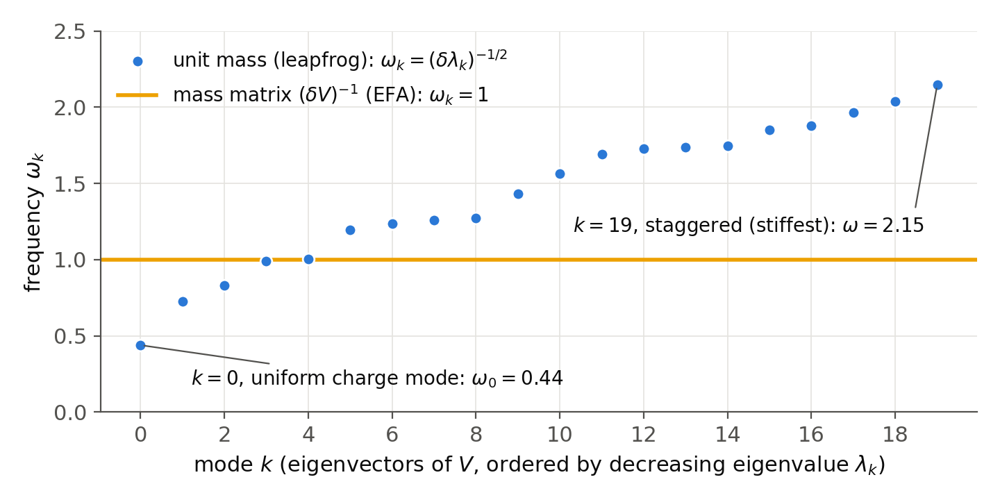
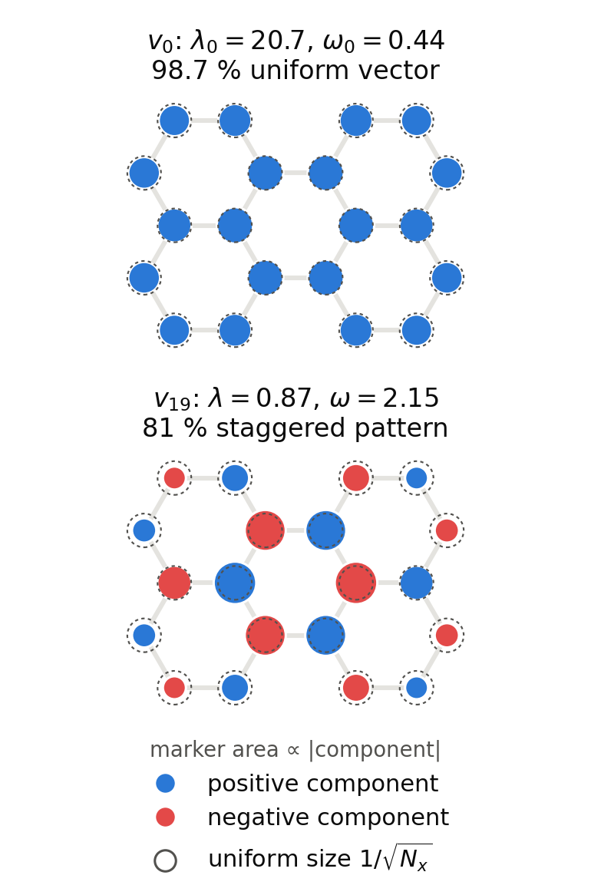
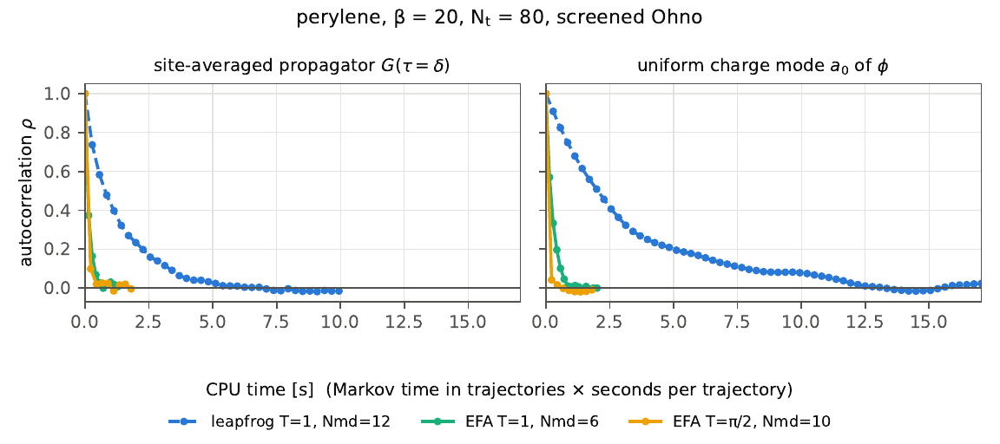

## The problem: a stiff gauge action

With unit mass, $H=\frac12\sum p^2+S_g+S_f$. Per time slice, the gauge action is diagonal in the eigenvectors
$v_k$ of $V$:

$$
S_g=\sum_t\sum_k\frac{(\phi_t\cdot v_k)^2}{2\,\delta\lambda_k}\qquad\Rightarrow\qquad\omega_k=(\delta\lambda_k)^{-1/2}
$$

Each term is a harmonic oscillator in molecular-dynamics time. *Stiff* means that the frequencies span a
wide range. Perylene, $\beta=20$, $N_t=80$ ($\delta=0.25$), screened Ohno: $\lambda(V)=0.87\ldots20.7$,
condition number 23.9, so $\omega$ spans a factor 4.9.

{fig-align="center" width="56%"}

## Normal modes and the amplitudes $a_k$

$V$ is real, symmetric and positive definite: $Vv_k=\lambda_kv_k$ with orthonormal $v_k$, numbered by
decreasing eigenvalue ($\lambda_0$ the largest).

- Expand every time slice in this basis, $\phi_t=\sum_k(\phi_t\cdot v_k)\,v_k$. The gauge action becomes a sum
  of $N_tN_x$ independent oscillators, one per slice $t$ and mode $k$. With unit mass, oscillator $(t,k)$ has
  frequency $\omega_k=(\delta\lambda_k)^{-1/2}$, the same on every slice.
- To follow a mode along the Markov chain I use one number per configuration, the **mode amplitude**
$$
a_k=\frac{1}{\sqrt{N_t\,\delta\lambda_k}}\sum_{t=0}^{N_t-1}\phi_t\cdot v_k
$$
  - The sum over $t$ keeps the static (time-averaged) part of the field along $v_k$. It oscillates with the
    same $\omega_k$.
  - The prefactor gives $\langle a_k^2\rangle=1$ when only $S_g$ acts: $\phi_t\cdot v_k$ is then Gaussian with
    variance $\delta\lambda_k$, independently on each slice.
- `ppp_autocorr.py` reports $a_k$ and $a_k^2$ for every $k$; some appear in the benchmark table.
- The names "$a_k$", "uniform charge mode" and "staggered mode" are my labels, not established terms.

## $a_0$: the uniform charge mode

:::: {.columns}
::: {.column width="62%"}
- All $V_{xy}>0$, so the top eigenvector $v_0$ has only positive components (Perron–Frobenius): 0.19–0.26
  for perylene, against $1/\sqrt{20}=0.22$ for a uniform vector. $v_0$ is 98.7 % uniform, so $a_0$ is
  essentially the time- and site-averaged field.
- The field enters as $e^{i\phi_t\cdot\hat q}$. Along $v_0$ it couples to $v_0\cdot\hat q\approx\hat Q/\sqrt{N_x}$,
  where $\hat Q=\sum_x\hat q_x$ is the **total charge** measured from half filling. Hence the name.
- $\lambda_0=20.7\approx\frac1{N_x}\sum_{xy}V_{xy}=20.5$: $U=3.3$ plus the long-range tail summed over the
  molecule, the Coulomb cost of charging it uniformly. Largest $\lambda$, so smallest $\omega_0=0.44$.
- At the other end, $v_{19}$ is 81 % staggered ($\pm$ on the two sublattices). Opposite neighbouring charges
  cancel most of the Coulomb sum, so $\lambda_{19}=0.87$ is the smallest and $\omega_{19}=2.15$ the largest.
- Hubbard ($V=U\mathbb 1$): all $\lambda_k=U$, no mode is singled out.
:::
::: {.column width="38%"}
{height="590px" fig-align="center"}
:::
::::

## What the stiffness costs the leapfrog

- **Step size** is set by the stiffest mode: stability needs $\epsilon\,\omega_\text{max}<2$, and the energy
  error grows like $(\epsilon\omega)^2$.
- **Decorrelation** is set by the slowest mode, $a_0$. In a trajectory of length $T=1$ it turns by only
  $\omega_0T=0.44$ rad. If only $S_g$ acted on it, its correlation after one trajectory would be
  $\cos(\omega_0T)=0.90$. The next slide shows that this is nearly the case.
- Measured: with the leapfrog, $a_0$ is the slowest observable of perylene ($\tau_\text{int}=11$ from the
  Γ method, 19 from bins of 500 trajectories).
- For Hubbard, $V=U\mathbb 1$ and all modes have the same frequency. The spread, here
  $\sqrt{23.9}\approx4.9$, is specific to the long-range $V$.

## Why the fermions barely act on $a_0$

- $\hat Q$ commutes with $\hat K$ and with every $\hat q_x$. A uniform shift of each slice,
  $\phi_t\to\phi_t+c_t\mathbf 1$, only multiplies each charge sector by a phase ($Z_Q$: trace at total charge $Q$):
$$
\operatorname{Tr}\prod_t e^{\delta\hat K}\,e^{i(\phi_t+c_t\mathbf 1)\cdot\hat q}=\sum_Q e^{iCQ}\,Z_Q[\phi],
\qquad C=\sum_tc_t .
$$
- At half filling and $\beta=20$, states with $Q\ne0$ cost the charge gap and have negligible weight. So
  $\det M_p\det M_h$ hardly depends on the uniform part of the field. Only $S_g$ acts on $a_0$, and it moves
  like a free oscillator.
- Quantitatively, integrating by parts in $\phi$ gives the exact identity
$$
\langle a_k^2\rangle=1-\beta\lambda_k\big\langle(v_k\cdot\bar q)^2\big\rangle,\qquad\bar q=\frac1{N_t}\sum_tq_t .
$$
  The fermions reduce the fluctuations of mode $k$ by the static charge fluctuations along $v_k$. For $k=0$
  these are the fluctuations of $Q$, which are frozen out.
- Measured (nine perylene and naphthalene chains): $\langle a_0^2\rangle=0.92$–$0.99$; all other modes $0.43$–$0.63$.

## The idea (Ostmeyer & Buividovich, arXiv:2404.09723)

Use the gauge kernel $A=(\delta V)^{-1}$ as the mass matrix:

$$
H=\frac12\sum_tp_t^TA^{-1}p_t+\underbrace{\frac12\sum_t\phi_t^TA\,\phi_t}_{S_0\,=\,S_g}+S_1(\phi),\qquad S_1=S_f
$$

- $H_0=\frac12p^TA^{-1}p+\frac12\phi^TA\phi$ gives $\dot\phi=A^{-1}p$, $\dot p=-A\phi$, so
  $\ddot\phi=-\phi$: **every mode has $\omega=1$**.
- $H_0$ is solved exactly:
$$
\phi(\tau)=\phi\cos\tau+A^{-1}p\,\sin\tau,\qquad p(\tau)=p\cos\tau-A\phi\,\sin\tau
$$
- Only the fermion force is integrated numerically.
- The momenta must follow $e^{-K}$: $p_t\sim\mathcal N(0,A)$.

## The integrator

Symmetric splitting of $H_0$ (exact rotation $R$) and $S_1$ (kick $K$), $\epsilon=T/N_\text{md}$:

```text
leapfrog, unit mass:  K(ε/2) D(ε) K(ε) D(ε) … K(ε) D(ε) K(ε/2)      Nmd + 1 force evaluations
EFA:                  R(ε/2) K(ε) R(ε) K(ε) … R(ε) K(ε) R(ε/2)      Nmd force evaluations
```

- $R(h)$: $(\phi,p)\mapsto(\phi\cos h+A^{-1}p\sin h,\;p\cos h-A\phi\sin h)$
- $K(h)$: $p\mapsto p+h\,F_1(\phi)$ with $F_1=-\partial S_f/\partial\phi=F_\text{total}+A\phi$.
  The code computes the full force from the action and adds back $A\phi$.
- $R$ and $K$ are exact flows of Hamiltonians, so their composition is **symplectic and reversible**.
  HMC stays exact for *any* positive-definite $A$; $A$ only affects efficiency.
- The gauge part has no integration error at any $\epsilon$: $\epsilon$ only has to resolve the fermion force.

## Why $T=\pi/2$

- For the Gaussian part alone, $\phi(\pi/2)=A^{-1}p$: after one trajectory the field is **independent** of
  the old one, for every mode at once.
- The fermion force spoils this partly, but it remains the best choice: with $T=\pi/2$ the measured
  $\tau_\text{int}$ of the propagator was 0.6–1.1 trajectories for perylene.
- $T=1$ is cheaper per trajectory and does about as well per CPU second (benchmarks below).

## The code: `operator()`

```cpp
torch::Tensor x = (isComplex ? torch::real(phi) : phi).clone();          // evolved
const torch::Tensor y = isComplex ? torch::imag(phi).clone() : torch::Tensor();  // offset, fixed
torch::Tensor P = (isComplex ? torch::real(pp) : pp).clone();            // real momentum

auto rotate = [&](double h){                       // exact flow of H_0
    const double c = std::cos(h), s = std::sin(h);
    torch::Tensor xNew = c*x + s*P.matmul(Ainv);
    P = c*P - s*x.matmul(A);
    x = std::move(xNew);
};
auto kick = [&](double h){                         // force of S - S_0
    q[key_] = field();
    torch::Tensor F = this->action_.force(q)[key_];
    if (isComplex) { F = torch::real(F); }
    P = P + h*(F + x.matmul(A));                   // the force of S_0 is -A x
};

rotate(0.5*stepSize_);
for(NSL::size_t n = 0; n < numSteps_; ++n){
    kick(stepSize_);
    rotate( (n+1 < numSteps_) ? stepSize_ : 0.5*stepSize_ );
}
```

Like `LeapfrogRealForce`: only $\operatorname{Re}\phi$ evolves, with the real part of the force; a constant
imaginary offset is kept.

## Mass matrix and constructors

```cpp
// PPP driver: A = S_gauge.invVtilde() = (δV)^{-1}
NSL::Integrator::ExactFourierAcceleration integrator(S, S_gauge, trajectoryLength, Nmd);

// any SPD matrix, e.g. Hubbard: A = 1/(δU) · 1   (sketch)
NSL::Integrator::ExactFourierAcceleration integrator(S, torch::eye(Nx, torch::kDouble)/(delta*U), T, Nmd);
```

- $A$, $A^{-1}$, $A^{1/2}$ come from one eigendecomposition in double precision on the CPU, and are converted
  to the field's dtype and device on use.
- The constructor checks that $A$ is real, square, symmetric and positive definite, and that $N_\text{md}\ge1$;
  every call checks that the configuration is the single field `phi` with $N_x$ sites per slice.
- `sampleMomentum`: $P=Z\,A^{1/2}$ with $Z$ standard normal, so $p_t\sim\mathcal N(0,A)$; real, stored with
  zero imaginary part for complex fields.
- `kineticEnergy`: $\frac12\sum_t p_t^TA^{-1}p_t$.
- For Hubbard all modes already share one frequency; EFA then only adds the exact Gaussian part and the
  $T=\pi/2$ choice.

## Getting a mass matrix into HMC

`HMC.tpp` and `RadialHMC.tpp` hard-coded $p\sim\mathcal N(0,1)$ and $K=\frac12p^2$. A mass matrix has to change
both, and consistently, or detailed balance breaks. The solution is a compile-time hook in `integrator.tpp`:

```cpp
template<typename IntegratorType, typename Type>
concept hasMassMatrix = requires(IntegratorType & integrator, const NSL::Configuration<Type> & config) {
    { integrator.sampleMomentum(config) } -> std::same_as<NSL::Configuration<Type>>;
    { integrator.kineticEnergy(config) }  -> std::convertible_to<Type>;
};

template<typename IntegratorType, NSL::Concept::isNumber Type>
NSL::Configuration<Type> sampleMomentum(IntegratorType & integrator, const NSL::Configuration<Type> & q){
    if constexpr (hasMassMatrix<IntegratorType,Type>) { return integrator.sampleMomentum(q); }
    else { /* the old unit-mass code: randn, imaginary part zeroed */ }
}
// kineticEnergy(integrator, p) analogous: integrator.kineticEnergy(p) or ½ Σ p²
```

In `HMC`/`RadialHMC`:

```cpp
NSL::Configuration<Type> momentum = NSL::Integrator::sampleMomentum(integrator_, state.configuration);
starting_H += NSL::Integrator::kineticEnergy(integrator_, momentum);
proposal_H += NSL::Integrator::kineticEnergy(integrator_, proposal_momentum);
```

## Properties of the hook

- Existing integrators do not define the two members, so they take the old code path and draw the same
  random numbers. Chains are **bit-identical** to before (checked: benzene, seed 2026, 60 configurations,
  equal action values).
- No virtual functions and no change to the existing integrator classes.
- The radial updates act on $\phi$ only and are unchanged.
- One deliberate change in the unit-mass path: real-typed fields now get unit-variance momenta.
  Before, they had variance 2 (deck 5, A8). Complex-typed drivers are unaffected.

## Driver, yml and autotuner

```yaml
Leapfrog:
  trajectory length: 1.5707963267948966   # pi/2
  Fourier acceleration: true              # default false: unit-mass leapfrog
  Nmd: 10
```

- The driver wraps everything after the integrator in a generic lambda `simulate(integrator)`, so both
  integrator types share one code path.
- `autotuner.py` is unchanged and tunes `Nmd` as before. Tested end to end on benzene ($\beta=4$): it
  converged to $N_\text{md}=2$ at 0.65 acceptance.
- At equal acceptance EFA needs about half the leapfrog's $N_\text{md}$.
- `yml/perylene.yml` and `ppp_geometry.py` default to EFA with $T=\pi/2$. The benchmark inputs keep the
  leapfrog they were validated with.

## Tests: `Tests/Integrator/test_exactFourierAcceleration.cpp`

8 test cases, 38 assertions, on a 4-site PPP ring (screened Ohno), all pass.

| test case | checks |
|---|---|
| the gauge action alone is integrated exactly | one step of length π/2 gives $\phi\to\delta V\,p$, $p\to-(\delta V)^{-1}\phi$ to $10^{-12}$; the leapfrog is far off |
| trajectories are reversible and keep the imaginary offset | forward + backward returns to the start; offsets 0 and 0.3 |
| the energy violation is of second order | $\Delta H$ ratio ≈ 4 when $N_\text{md}$ doubles (40 → 80 → 160) |
| phase-space volume is preserved | finite-difference Jacobian determinant ≈ 1 |
| momenta follow $\exp(-K)$ | covariance of $p$ = $A$; $\langle K\rangle$ = d.o.f./2 |
| HMC hooks select the kinetic term of the integrator | `static_assert` on `hasMassMatrix`; kinetic energies |
| unit-mass momenta have unit variance for real and complex fields | the variance-2 bug (deck 5, A8) |
| invalid mass matrices are rejected | non-symmetric, non-positive, wrong size |

## Benchmarks

$\beta=20$, $N_t=80$, screened Ohno, $N_\text{radial}=1$, Release build, 3–4 chains in parallel on your laptop.
Cost per independent sample $=2\tau\times$(s/trajectory), $\tau$ the larger of the Γ-method and binned
estimates.

| molecule | integrator, $T$, $N_\text{md}$ | acc. | s/traj | $\tau$ $G(1$–$4)$ | cost $G$ | slowest observable, $\tau$ | cost slowest |
|---|---|---|---|---|---|---|---|
| naphthalene | leapfrog, 1, 7 | 0.78 | 0.048 | 4.8 | 0.45 s | $S_f$, 13 | 1.27 s |
| naphthalene | leapfrog, π/2, 10 | 0.74 | 0.063 | 3.0 | 0.38 s | $S_f$, 18 | 2.3 s |
| naphthalene | EFA, 1, 3 | 0.80 | 0.023 | 2.1 | 0.10 s | $a_6^2$, 2.3 | 0.11 s |
| naphthalene | **EFA, π/2, 5** | 0.81 | 0.032 | 1.1 | 0.073 s | $a_9^2$, 3.1 | 0.20 s |
| perylene | leapfrog, 1, 12 | 0.90 | 0.284 | 5.1 | 2.9 s | $a_0$, 19 | 11.0 s |
| perylene | EFA, 1, 6 | 0.87 | 0.143 | 1.9 | 0.55 s | $S_f$, 16 | 4.7 s |
| perylene | **EFA, π/2, 10** | 0.92 | 0.226 | 0.74 | 0.33 s | $a_{18}^2$, 2.4 | 1.07 s |

With $T=\pi/2$: 6–9× cheaper per independent propagator sample, 6–10× for the slowest observable.
Second perylene chains: $\tau_G$ = 0.9–1.0 (EFA, $T=1$) and 0.6–1.1 (EFA, $T=\pi/2$).

[$G(n)$: site-averaged particle propagator at $n$ time slices; $\tau\,G(1$–$4)$ is the largest $\tau$ of
$G(1)$, $G(2)$, $G(4)$. $S_f=S-S_g$. $a_k^2$: squared mode amplitude.]{.small .muted}

## Check: $a_0$ behaves like a free oscillator

If only $S_g$ acts, a trajectory maps $a_0\to a_0\cos(\omega_0T)+(\text{fresh momentum})\sin(\omega_0T)$, and a
rejection leaves $a_0$ unchanged. With acceptance rate $P$ the lag-1 autocorrelation should be

$$
\rho_1\approx P\cos(\omega_0T)+(1-P),\qquad\omega_0=0.44\ \text{(perylene)},\ 0.54\ \text{(naphthalene)},\quad\omega_0=1\ \text{with EFA}.
$$

| molecule | integrator, $T$ | $\omega_0T$ | $P$ | $\rho_1$ predicted | $\rho_1$ measured |
|---|---|---|---|---|---|
| perylene | leapfrog, 1 | 0.44 | 0.90 | 0.91 | 0.91 |
| perylene | EFA, 1 (two chains) | 1 | 0.87, 0.93 | 0.60, 0.57 | 0.57, 0.54 |
| perylene | EFA, π/2 (two chains) | π/2 | 0.92, 0.92 | 0.08, 0.08 | 0.04, 0.03 |
| naphthalene | leapfrog, 1 | 0.54 | 0.78 | 0.89 | 0.89 |
| naphthalene | leapfrog, π/2 | 0.85 | 0.74 | 0.75 | 0.75 |
| naphthalene | EFA, 1 | 1 | 0.80 | 0.63 | 0.62 |
| naphthalene | EFA, π/2 | π/2 | 0.81 | 0.19 | 0.18 |

- All nine chains agree within 0.06. EFA at $T=\pi/2$ has $\cos(\omega_0T)=0$: each accepted trajectory renews $a_0$.
- Geometric decay gives $\tau_\text{int}=\frac12(1+\rho_1)/(1-\rho_1)$: 11.2 for the perylene leapfrog, measured
  $10.9\pm2.3$ (Γ method). The table's 19 comes from 10 bins of 500 and is uncertain by about ±50 %.

## Autocorrelation, perylene

The horizontal axis is CPU time, so the curves compare the cost of decorrelating. Naphthalene looks the same
(`images/efa_autocorrelation_naphthalene.png`).

{fig-align="center" width="82%"}

## Are the accelerated chains correct?

- **Naphthalene vs ED:** all four integrator settings agree, $p=0.19$–$0.50$. Deterministic `invM` checks
  ≤ $1.9\cdot10^{-12}$.
- **Perylene** (no ED possible): five chains of 5000 trajectories (leapfrog, 2× EFA $T=1$, 2× EFA $T=\pi/2$).
  - Propagators $G(1$–$20)$ agree, $p=0.02$–$0.35$, errors from 10 bins of 500.
  - The action terms agree except for the EFA $T=1$ chain with a long early excursion (next slide).
  - The spread is somewhat larger than these errors imply. That fits the excursions, and 10-bin errors are
    themselves uncertain by ≈ 25 %.
- The unit tests check exactness (reversibility, volume, energy conservation order, momentum distribution)
  independently of any ensemble.

## Caveat: rare excursions, with every integrator

- Occasionally a chain enters a region of larger fermion action (smaller $\lvert\det M\rvert$) and stays for a
  few hundred to ≈ 2000 trajectories.
- Seen with the leapfrog (both naphthalene leapfrog runs), with EFA $T=1$ (one perylene chain, right after
  thermalization, $S_f$ ≈ 3–4 above its mean for ≈ 2000 trajectories) and, weaker, with EFA $T=\pi/2$. So it is
  not caused by EFA. I have not identified the cause.
- The automatic Γ window misses this slow tail. `ppp_autocorr.py` also reports binned $\tau$ and marks
  such observables with `!`.

For production:

- thermalize generously (a few thousand trajectories are cheap with EFA) and watch $S_f$;
- run several independent chains; take errors from bins of ≥ 500 trajectories or from the chain-to-chain spread.

## Practical notes

- **Disk space.** The spatial measurement of `propagator` stores `invM[t,s]`, `invM[s,t]`, `invM[t,t]` for every source and
  species: ≈ 8.6 MB per perylene configuration at $N_t=80$ with 4 sources, i.e. 43 GB per 5000
  configurations (naphthalene 2.1 MB). Plan Jureca storage, or reduce `Number Time Sources`.
- **Autocorrelation analysis:**
  `python python/ppp_autocorr.py run.yml [run.h5] --seconds-per-trajectory s`.
  It covers the action terms, the field amplitudes $a_k$ along the eigenvectors of $V$, and the propagator
  if measured.
- Still open from the original step 4: several trajectories per autotuner launch, and packing chains onto
  Jureca nodes.

[Reference: J. Ostmeyer and P. Buividovich, *Minimal autocorrelation in Hybrid Monte Carlo simulations using
exact Fourier acceleration*, [arXiv:2404.09723](https://arxiv.org/abs/2404.09723).]{.small}
