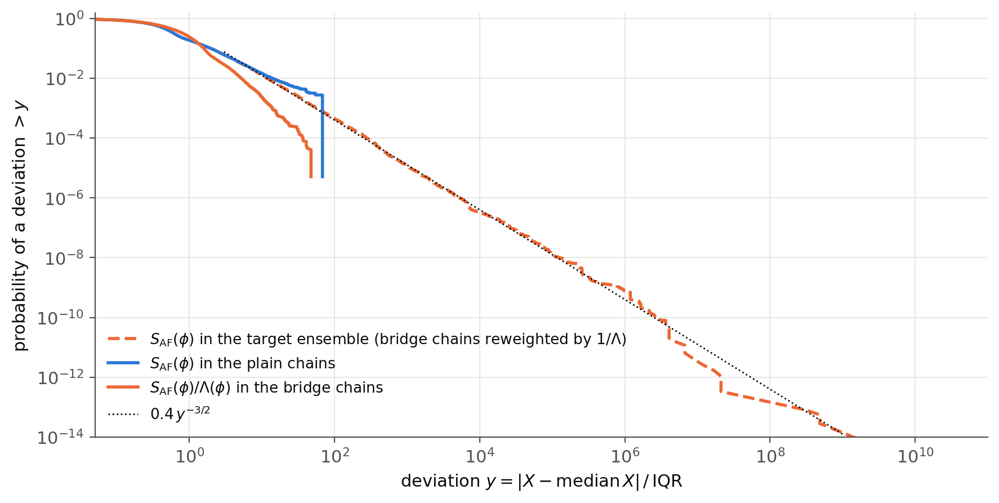
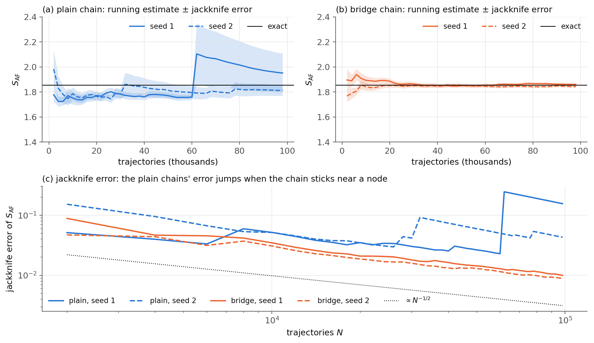
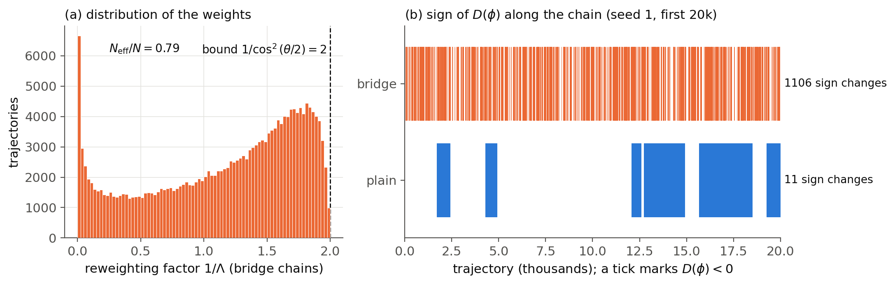

## Overview

- **Problem.** In our charge-basis HMC, every estimator *quadratic* in the propagator has infinite variance:
  equal-time spin and charge correlations, the local moment, and every two-body correlator (excitons, pp
  pairs). The sample mean still converges, but slowly and erratically, and the jackknife error is wrong.
  In HMC the same cause also makes the chain stick for hundreds of trajectories, and makes it rarely cross
  between the two sign regions of $\det M_p$.
- **Fix.** Sample a modified weight without zeros, $w(\phi)\,\Lambda(\phi)$, and divide each configuration
  back by $\Lambda(\phi)$. This is exact: no bias, and no extra Trotter error. $\Lambda$ is a function of the
  equal-time propagator at one time slice, which the measurement already stores.
- **Origin.** The idea comes from Shi & Zhang (2016) and the "exact bridge link" of Wan & Zhang (2025), both for
  ground-state AFQMC. This deck adapts it to finite temperature, the charge basis and HMC.

| part | status |
|---|---|
| sampler: `BridgeLink`, field shift in `HubbardFermionAction`, hook in `RadialHMC`, PPP driver option | done, tested, validated on a 4-site chain (commit 658057b) |
| analysis: $\Lambda$ per configuration, reweighting in both reductions and in `ppp_analysis`, notebook diagnostics | done, tested, validated end to end on the 4-site chain (commit f89cf34) |
| production | the $N_t=256$ runs were made without the bridge; a perylene test at $N_t=128$ (40 chains $\times$ 500 per interaction, `perylene_*_b32_Nt128_bridge.yml`) is set up, with the plain $N_t=128$ production as the reference |

## Terms used in this deck

Several of these are my own labels.

| term | meaning |
|----------------------|----------------------------------------------------------------|
| target weight $w(\phi)$ | $e^{-S_g(\phi)}\lvert\det M_p(\phi)\rvert^2$: the ensemble we want ($\mu=0$, bipartite, real $\phi$) |
| $D(\phi)$ | $e^{-i\sum_{t,x}\phi_{t,x}/2}\det M_p(\phi)$, which is **real** |
| node, sign region | the hypersurface $D(\phi)=0$ in field space; a connected region where $D$ has one sign |
| $d$ | distance of a configuration from the nearest node |
| plain chain | HMC with the target weight, as in all production runs so far |
| $n_i(t)$, $y_i(t)$ | generalized density $\langle c^\dagger_i c_i\rangle_\phi$ at slice $t$ (complex); $y=\mathrm{Im}\,n$ |
| bridge slice $b$, angle $\theta$ | where the bridge operator sits, and its phase; defaults $b=0$, $\theta=\pi/2$ |
| bridge term $k=(i,x)$ | site $i$ and sign $x=\pm1$; field shift $c_k=\theta x\,e_{b,i}$ (only $\phi_{b,i}$ moves) |
| bridge ratio $R_k(\phi)$ | $\lvert\det M_p(\phi+c_k)\rvert^2/\lvert\det M_p(\phi)\rvert^2$ |
| bridge value $\Lambda(\phi)$ | $\frac{1}{2N_x}\sum_k R_k(\phi)$; the configuration's reweighting factor is $1/\Lambda$ |
| bridge ensemble, bridge chain | weight $w\Lambda$; the chain that samples it |
| sticking | many consecutive rejected trajectories at one configuration |
| deviation $y$, tail exponent $\alpha$ | $y=\lvert X-\mathrm{median}\rvert/\mathrm{IQR}$ (as in the notebook's heavy-tail diagnostic); $P(\text{deviation}>y)\sim y^{-\alpha}$ |
| $N_\mathrm{eff}$ | effective number of samples after reweighting, $(\sum_j w_j)^2/\sum_j w_j^2$ with $w_j=1/\Lambda_j$ |

# The problem

## The weight has zeros

At $\mu=0$ on a bipartite lattice with a real field:

$$
\det M_h(\phi)=\det M_p(\phi)^*,\qquad
w(\phi)=e^{-S_g(\phi)}\,\lvert\det M_p(\phi)\rvert^2\ \ge 0,\qquad
\det M_p(\phi)=e^{\,i\sum_{t,x}\phi_{t,x}/2}\,D(\phi),\quad D\ \text{real}.
$$

- There is no sign problem, but **$D$ changes sign**. It does so on hypersurfaces in field space (the nodes),
  so the field space splits into sign regions. Both carry weight: in the 4-site chain, about 40 % of the target
  ensemble has $D<0$ (0.393(11) and 0.402(9), from the reweighted bridge chains).
  $D$ real is checked numerically to $6\cdot10^{-15}$ (`bridge_proto.py check`).
- The weight vanishes **quadratically** at a node: $w\propto d^2$.
- The propagator diverges there: $G=M_p^{-1}=\operatorname{adj}M_p/\det M_p\sim 1/d$.
- For HMC, $S_f=-2\log\lvert D\rvert\to+\infty$ at a node. The force $\propto 1/d$ is a wall. Exact molecular
  dynamics never crosses it; with a finite step size a trajectory sometimes jumps across.

## Why the variance is infinite

Near a node, count the powers of $d$. The weight per unit distance is $\propto d^2$. An estimator of order $p$ in
$G$ behaves as $O\sim d^{-p}$, so

$$
P(\lvert O\rvert>x)=P\big(d<x^{-1/p}\big)\propto\int_0^{x^{-1/p}}d^2\,\mathrm d d\ \propto\ x^{-3/p}
\qquad\Rightarrow\qquad \alpha=3/p .
$$

| order $p$ in $G$ | examples | $\alpha$ | mean | variance |
|---|---|---|---|---|
| 1 | single-particle correlators $G(\tau)$ | 3 | finite | finite |
| 2 | $S_\mathrm{AF}$, $S_\mathrm{CDW}$, $\langle s^2\rangle$, double occupancy, exciton and pp correlators | 3/2 | finite | **infinite** |

- With $1<\alpha<2$ the central limit theorem does not apply. The mean converges like $N^{1/\alpha-1}=N^{-1/3}$
  instead of $N^{-1/2}$. The usual error bar is too small, and the distribution of the sample mean is skewed:
  **the typical estimate lies below the true value**, with rare large jumps upward.
- Shi & Zhang (2016) identified this problem in AFQMC. Wan & Zhang (2025) fit $\alpha=1.51\pm0.04$ to the
  energy of the half-filled Hubbard model; that is $p=2$, because the interaction energy is quadratic in $G$.

## The tail, measured

{fig-align="center" width="74%"}

4-site open chain, $U=4$, $\beta=4$, $N_t=16$; $2\times10^5$ trajectories of each kind (Python prototype).

- **Dashed:** the target distribution of $S_\mathrm{AF}(\phi)$, reconstructed from the bridge chains by
  reweighting. It follows $0.4\,y^{-3/2}$ over nine decades, so $\alpha=3/2$ as predicted.
- **Blue:** the plain chains follow it only up to $y\approx70$ and then stop. The wall keeps plain HMC away from
  the nodes. It gets close only when it sticks.
- **Orange solid:** the numerator $S_\mathrm{AF}/\Lambda$ of the bridge estimator has a light tail.

## Symptoms in a plain chain

{fig-align="center" width="80%"}

- Plain seed 1 after $6\cdot10^4$ trajectories: $S_\mathrm{AF}=1.759(23)$, 4.1 σ below the exact 1.854. This is
  the "typical estimate too low" of the previous slide.
- At trajectory 63 255 the chain **sticks**: 543 consecutive rejected trajectories at one configuration with
  $S_\mathrm{AF}=41$ and $\Lambda=15$, i.e. close to a node. That stretch alone moves the mean up by 0.23 and
  makes the error 7× larger.
- The bridge chains converge like $N^{-1/2}$, agree with each other, and agree with the exact value.

# The idea

## Reweighting from a modified ensemble

For any $\Lambda(\phi)>0$, write $\langle\cdot\rangle_\Lambda$ for the average in the ensemble with weight $w\Lambda$:

$$
\langle O\rangle=\frac{\int w\,O}{\int w}
=\frac{\big\langle O/\Lambda\big\rangle_\Lambda}{\big\langle 1/\Lambda\big\rangle_\Lambda},
\qquad
\big\langle(O/\Lambda)^2\big\rangle_\Lambda=\frac{\int w\,O^2/\Lambda}{\int w\,\Lambda}.
$$

Requirements on $\Lambda$:

1. $w\Lambda$ can be sampled with the HMC we have: non-negative, with a force.
2. $1/\Lambda$ is bounded, so the denominator is harmless.
3. $\Lambda$ grows near a node at least as fast as $O$. Then $\Lambda\sim d^{-2}$ gives
   $w\,O^2/\Lambda\sim d^2\cdot d^{-4}\cdot d^{2}$, which is finite.
4. $\Lambda$ is cheap to evaluate on every stored configuration.

The ensemble that is sampled is not the target, but the ratio is exact. The only cost is statistical: the
weights $1/\Lambda$ vary, which reduces $N\to N_\mathrm{eff}$.

## Where the idea comes from

- **Shi & Zhang**, Phys. Rev. E **93**, 033303 (2016), [arXiv:1511.04084](https://arxiv.org/abs/1511.04084).
  Ground-state AFQMC. The "bridge link" inserts one extra time slice $e^{-\Delta\tau H}$ in the middle of the
  path. It is sampled as an ordinary auxiliary-field slice, and the exact $e^{-\Delta\tau H}$ is evaluated
  approximately (second-order expansion or sub-sampling).
- **Wan & Zhang**, Phys. Rev. E **112**, 065309 (2025), [arXiv:2507.08937](https://arxiv.org/abs/2507.08937).
  The "exact bridge link": the inserted operator is a finite sum of sign-free terms, each one an ordinary value
  of an extra auxiliary field. For the attractive Hubbard model they use
  $\Lambda=\frac1N\sum_{i,x=\pm1}e^{i\theta x(n_{i\uparrow}-n_{i\downarrow})}$, $\theta\in(0,\pi)$, with the
  bound $\Lambda_\text{loc}\ge1+\cos\theta$. The paper also corrects error bars of existing data, using $\alpha$.
- **Here.** The same operator, mapped to the repulsive model. The partial particle–hole transformation
  $c_{x\downarrow}\to(-1)^x c^\dagger_{x\downarrow}$ turns $n_\uparrow-n_\downarrow$ into the charge
  $q=n_\uparrow+n_\downarrow-1$. It works at finite temperature, in HMC, and is inserted at an existing slice as a
  shift of the field, without an extra slice. With our normalization $1/(2N_x)$ their bound is our
  $\cos^2(\theta/2)$. I did not find this finite-temperature HMC version in the literature; it is derived and
  checked in this deck.

# The construction

## The bridge operator

$$
\hat\Lambda=\frac{1}{2N_x}\sum_{i}\sum_{x=\pm1}e^{\,i\theta x\,q_i}=\frac{1}{N_x}\sum_i\cos(\theta\,q_i)
$$

| site state | $q$ | $s$ | $\cos(\theta q)$ | at $\theta=\pi/2$ |
|---|---|---|---|---|
| empty | $-1$ | 0 | $\cos\theta$ | 0 |
| $\uparrow$ or $\downarrow$ | 0 | $\pm1$ | 1 | 1 |
| $\uparrow\downarrow$ | $+1$ | 0 | $\cos\theta$ | 0 |

- Since $q^2+s^2=1$ on every site: $\hat\Lambda=\cos\theta+(1-\cos\theta)\,\frac1{N_x}\sum_i s_i^2$.
  **At $\theta=\pi/2$, $\hat\Lambda$ is the local-moment density** at slice $b$.
- The bridge ensemble is the target with $\hat\Lambda$ inserted at slice $b$:
  $\int w\,\Lambda=Z\,\langle\hat\Lambda\rangle$. This gives a built-in check:

$$
\big\langle 1/\Lambda\big\rangle_\Lambda=\frac{1}{\langle\hat\Lambda\rangle}
\ \overset{\theta=\pi/2}{=}\ \frac{1}{\langle s^2\rangle}.
$$

## Inserting it is a shift of the field

- In the charge basis the field at $(t,x)$ enters the transfer matrix as $e^{\,i\phi_{t,x}q_x}$: particles see
  $e^{i\phi}$, holes $e^{-i\phi}$, and $q=n_p-n_h$.
- So $e^{\,i\theta x\,q_i}$ at slice $b$ is the same as $\phi_{b,i}\to\phi_{b,i}+\theta x$:

$$
R_k(\phi)\equiv\frac{\det M_p(\phi+c_k)\,\det M_h(\phi+c_k)}{\det M_p(\phi)\,\det M_h(\phi)}
=\big\langle e^{\,i\theta x\,q_i(b)}\big\rangle_\phi,
\qquad c_k=\theta x\,e_{b,i}.
$$

- **Joint weight** of the pair $(\phi,k)$: $P(\phi,k)\propto e^{-S_g(\phi)}\,\lvert\det M_p(\phi+c_k)\rvert^2$.
  Every term is an ordinary charge-basis weight at a shifted field, so it is non-negative and has a force.
  The gauge action stays at $\phi$.
- **Marginal** of $\phi$: $\sum_kP(\phi,k)\propto w(\phi)\,\Lambda(\phi)$, with
  $\Lambda(\phi)=\frac1{2N_x}\sum_kR_k(\phi)=\langle\hat\Lambda(b)\rangle_\phi$.
- The identity holds exactly on the lattice: same $N_t$, same Trotter error as the target, no new slice.

## The bridge ratios in closed form

For a fermion number $n\in\{0,1\}$, $e^{i\alpha n}=1+(e^{i\alpha}-1)\,n$ as an operator. For a fixed $\phi$ the
fermions are free and particles and holes are independent, so with $n^h=n^*$ ($\mu=0$, bipartite):

$$
R_{i,x}=\big|1+(e^{i\theta x}-1)\,n_i(b)\big|^2,\qquad n_i(t)=\langle c^\dagger_ic_i\rangle_\phi=1-G_{ii}(t,t).
$$

(checked in NSL's conventions to $5\cdot10^{-14}$). Equivalently, $\det M_p$ is affine in each $e^{i\phi_{t,x}}$.

**$\mathrm{Re}\,n=\tfrac12$ on every configuration.** Affinity gives
$\partial\log\det M_p/\partial\phi_{t,x}=i\,n_x(t)$. With $\det M_p=e^{i\sum\phi/2}D$ and $D$ real, this
becomes $n=\tfrac12+iy$ with

$$
y_x(t)=-\frac{\partial\log\lvert D\rvert}{\partial\phi_{t,x}}=\tfrac12\,\frac{\partial S_f}{\partial\phi_{t,x}} .
$$

Then $1+(e^{i\alpha}-1)(\tfrac12+iy)=e^{i\alpha/2}\big[\cos\tfrac\alpha2-2y\sin\tfrac\alpha2\big]$, so

$$
R_{i,\pm}=\Big(\cos\tfrac\theta2\mp2y_i(b)\sin\tfrac\theta2\Big)^2,\qquad
\Lambda=\cos^2\tfrac\theta2+4\sin^2\tfrac\theta2\ \bar y^{\,2},\qquad
\bar y^{\,2}=\frac1{N_x}\sum_iy_i(b)^2 .
$$

The heat bath therefore gets all $2N_x$ ratios from **one gradient of $S_f$** at the unshifted field.

## The ratios and the weight

{fig-align="center" width="88%"}

- **(a)** The two shifts of one site; each can vanish, but their mean never drops below $\cos^2(\theta/2)$.
- **(b)** $1/\Lambda$ is largest, $1/\cos^2(\theta/2)$, for configurations far from any node ($\bar y=0$) and
  falls like $\bar y^{-2}$ near one.
- At $\theta=\pi/2$, $\Lambda(\phi)=\frac1{N_x}\sum_i\big(\tfrac12+2y_i^2\big)$, which is the configuration's
  value of the local moment $\langle s_i^2\rangle_\phi=\tfrac12+2y_i^2$ at slice $b$. Configurations with a large
  apparent moment are those close to a node.

## Near a node

{fig-align="center" width="60%"}

The plot follows a straight line between two Gaussian fields of opposite sign of $D$ (4-site chain), at
$\lvert s-s_0\rvert=10^{-6}$ from the node:

- $\lvert\det M_p\rvert^2$ is $5\cdot10^{-11}$ of its maximum;
- $S_\mathrm{AF}=8\cdot10^{9}$ and $\Lambda=3\cdot10^{9}$, but $S_\mathrm{AF}/\Lambda=2.74$;
- the bridge weight never drops below 8 % of its maximum on the line.

## Why the variance is now finite

Near a node, $y_i(b)=-\partial_{b,i}D/D\sim 1/d$, so $\Lambda\sim d^{-2}$: as fast as any estimator quadratic in
$G$.

| near a node | plain chain | bridge chain |
|---|---|---|
| sampled weight | $w\propto d^2$, vanishes | $w\Lambda$ finite, no node |
| estimator | $O\sim d^{-2}$ | numerator $O/\Lambda$ bounded |
| reweighting factor | — | $1/\Lambda\le1/\cos^2(\theta/2)$, $\to0$ at the node |
| variance | $\int w\,O^2\sim\int d^{-2}\,\mathrm dd=\infty$ | $\int w\,O^2/\Lambda\sim\int d^{\,0}\,\mathrm dd$, finite |
| HMC | the force $\propto1/d$ is a wall; sticking | the term $k$ changes before every trajectory |

- **Caveat.** This is local power counting, not a proof. It needs $\partial D/\partial\phi_{b,i}\neq0$ for some
  $i$ where the trajectory meets the node, which is the generic case. Measured: the tail of the numerator has a
  Hill exponent $\alpha\approx2.5$, so its variance is finite; the target's exponent is 1.5.
- At fixed $k$, HMC still sees the nodes of $\lvert\det M_p(\phi+c_k)\rvert^2$. Near such a node $R_k\approx0$,
  so the next heat bath almost surely moves to another term. Hence spikes in $\Delta H$ still occur, but the chain
  no longer sticks: the longest run of rejections is 39 and 18 trajectories, against 542 and 114 in the plain
  chains.

# The chain and the code

## The joint chain

The state of the chain is the pair $(\phi,k)$. Every update cycle does:

1. **Heat bath on $k$** at fixed $\phi$: draw $k$ with probability $R_k(\phi)/\sum_{k'}R_{k'}(\phi)$, then set the
   shared shift to $c_k$.
2. **HMC and radial updates of $\phi$** at fixed $k$, with the action $S_g(\phi)+S_f(\phi+c_k)$.
3. **Store $\phi$** (unshifted).

- Each step leaves $P(\phi,k)$ invariant. The stored $\phi$ are therefore distributed with $w\Lambda$.
- The heat bath costs one gradient of $S_f$ at the unshifted $\phi$, about one molecular-dynamics step. That is
  +15 % at $N_\mathrm{md}=6$.
- The measurement program sees only $\phi$, so nothing changes there. $\Lambda$ is recomputed in the analysis
  from the stored $G(b,b)$.
- The action value stored with each configuration is $S_g(\phi)+S_f(\phi+c_k)$, the action of the current
  term, not of $\phi$.

## Choosing $\theta$ and $b$

- $\theta\in(0,\pi)$. A small $\theta$ makes the weights nearly uniform ($1/\Lambda\le1/\cos^2(\theta/2)\to1$),
  but $\Lambda$ then grows near a node only as $4\sin^2(\theta/2)\,\bar y^2$. As $\theta\to\pi$ the floor
  $\cos^2(\theta/2)\to0$: the weights spread out and $N_\mathrm{eff}$ drops.
- The default $\theta=\pi/2$ gives $1/\Lambda\le2$, makes $\hat\Lambda$ the local moment, and gives
  $N_\mathrm{eff}/N=0.79$ on the 4-site chain. It has not been tuned.
- $b$: any slice. The target is time-translation invariant, so $b$ only says where $\hat\Lambda$ sits. The default
  is 0.
- A possible extension, not implemented: average $\hat\Lambda$ over all slices as well ($2N_xN_t$ terms). The
  same gradient already contains every $y_i(t)$.

## Requirements

- The charge basis (`HubbardExp`), $\mu=0$, a bipartite lattice and a real field (no `offset`). Together these
  make $D$ real, so $\mathrm{Re}\,n=\tfrac12$, $R_k\ge0$, and the bound holds.
- Otherwise $R_k=\langle e^{i\theta xq_i}\rangle_\phi$ is complex and is not a probability. The driver refuses to
  start in that case.
- PPP is fine: $V$ enters only $S_g$, which the bridge does not touch. Perylene and the other benzenoids are
  bipartite at $\mu=0$.
- The spin basis is not supported. Its field couples to $s$ with a real exponent, so this construction does not
  carry over.

## Code: library

| file | change |
|---|---|
| `Action/Implementations/hubbardFermiAction.tpp` | `setShift(std::shared_ptr<Tensor>)`: `eval`, `grad` and `force` at $\phi+$shift. The pointer is **shared** by all copies (the summed `Action`, the integrator's copy), so the heat bath changes every copy at once. `nullptr` (default) means no shift |
| `MarkovChain/bridgeLink.tpp` (new) | `NSL::MCMC::BridgeLink`: `ratios(phi)`, `lambda(phi)`, the heat bath `operator()(config)`, `term()`, `lastLambda()` |
| `MarkovChain/RadialHMC.tpp` | template parameter `PreTrajectoryType` (default `NoPreTrajectory`, does nothing), called before every trajectory. If it returns `true` the stored action value is recomputed |
| `MCMC.hpp` | includes `bridgeLink.tpp` |

```cpp
// BridgeLink::operator(): heat bath for k at fixed phi
const std::vector<double> R = ratios(config["phi"]);   // one grad of S_f at the unshifted field
double total = 0; for (double r : R) total += r;
const double u = r_.rand()[0] * total;
NSL::size_t k = 0;
for (double acc = R[0]; acc < u && k + 1 < R.size(); acc += R[++k]) {}
(*shift_) = Type(0);
(*shift_)(slice_, k / 2) = Type(theta_ * ((k % 2) ? -1. : 1.));   // seen by every copy of S_f
```

## Code: driver and yml

```yaml
HMC:
  bridge:
    theta: 1.5707963267948966   # pi/2
    slice: 0
```

- `autotune_RadialMCMC_PPP` reads the block, refuses to run unless the setup is charge basis, $\mu=0$, offset 0
  and bipartite, and logs `Bridge link: theta = ..., time slice 0; reweight measurements by 1/Lambda`. Without the
  block nothing changes.
- It records $\theta$ and $b$ in `<name>/Meta/bridge/{theta, slice}` of the h5 file. A chain keeps them for life:
  continuing a plain chain with a bridge, a bridge chain without one, or with another $\theta$ or $b$ stops with
  an error, because it would mix two ensembles in one chain (all three cases tested).
- The measurement program (`Executables/Hubbard/propagator`) is unchanged: it measures at the stored, unshifted
  $\phi$.

## Tests of the sampler

- **`Tests/MarkovChain/test_bridgeLink.cpp`** (4-site ring, $N_t=8$). It checks:
  - $R_k$ equals the determinant ratio $e^{-(S_f(\phi+c_k)-S_f(\phi))}$ to $10^{-8}$;
  - $\Lambda\ge\cos^2(\theta/2)$;
  - the shift is seen by `S_fermion` and by the summed `Action`;
  - `lastLambda()` is correct;
  - the heat-bath frequencies lie within 5 σ over 4000 draws.
- **`notes/scripts/bridge_proto.py check`** (the independent Python prototype). It checks:
  - $D$ is real to $6\cdot10^{-15}$;
  - $\mathrm{Re}\,n=\tfrac12$ to $9\cdot10^{-14}$;
  - the closed form of $R_k$ to $5\cdot10^{-14}$;
  - $\Lambda/\cos^2(\theta/2)\ge1$.

# Validation

## 4-site chain: Python prototype

$U=4$, $\beta=4$, $N_t=16$, open chain; $10^5$ trajectories per chain, the first 2000 discarded, bins of 500.
Exact values from Fock space at the same $N_t$.

| chain | $S_\mathrm{AF}$ | $S_\mathrm{CDW}$ | $\langle s^2\rangle$ | sign changes |
|---|---|---|---|---|
| plain, seed 1 | 1.952(156) | 0.140(167) | 0.943(91) | 69 |
| plain, seed 2 | 1.813(43) | 0.299(47) | 0.852(21) | 62 |
| bridge, seed 1 | 1.860(10) | 0.245(10) | 0.8651(39) | 5202 |
| bridge, seed 2 | 1.843(9) | 0.258(11) | 0.8581(35) | 5105 |
| **exact** | **1.8540** | **0.2521** | **0.8626** | |

- The bridge errors are 4–23× smaller at the same number of trajectories, and every pull is ≤ 1.3 σ.
- Built-in check: $\langle1/\Lambda\rangle_\Lambda=1.1568(38)$ and $1.1630(37)$, against
  $1/\langle s^2\rangle=1.1592$.
- The plain chains' $\langle\Lambda\rangle$ (= $\langle s^2\rangle$ at $\theta=\pi/2$) gives 0.894(58) and
  0.844(24). It has infinite variance in the plain ensemble, like any estimator quadratic in $G$.

## Weights and sign regions

{fig-align="center" width="88%"}

- **(a)** Reweighting costs about 20 % of the samples ($N_\mathrm{eff}/N=0.79$). The peak at $1/\Lambda\approx0$
  holds configurations very close to a node: the bridge chain passes through them ($S_\mathrm{AF}$ up to
  $10^{11}$) and they get almost no weight.
- **(b)** The plain chain stays in one sign region for thousands of trajectories. The bridge chain changes sign
  about every 20 trajectories.

## 4-site chain: the NSL driver end to end

`autotune_RadialMCMC_PPP` with `PPP: form: onsite`. Settings: EFA, $N_\mathrm{md}=6$, $T=\pi/2$, radial scale
$1/8=1/\sqrt{N_tN_x}$; 20 000 configurations each. Observables and $\Lambda$ were computed from the stored $\phi$.

| run | $S_\mathrm{AF}$ | $S_\mathrm{CDW}$ | $\langle s^2\rangle$ | sign changes |
|---|---|---|---|---|
| plain | 1.815(46) | 0.263(48) | 0.847(17) | 69 |
| bridge | 1.861(22) | 0.260(21) | 0.8665(84) | 1201 |
| exact | 1.8540 | 0.2521 | 0.8626 | |

- $R_k$ equals the determinant ratio on stored configurations to $4.5\cdot10^{-14}$ in NSL's conventions.
- HMC: acceptance 0.64 (plain) and 0.61 (bridge). $\langle e^{-\Delta H}\rangle$ is 0.78 and 0.75, below 1 in
  **both** runs, so it is not caused by the bridge. On this tiny system $N_\mathrm{md}=6$ produces $\Delta H$
  spikes in both.

# Analysis

## Reweighting in the analysis

- **$\Lambda$ per configuration** (`ppp_reduce.bridge_lambda`) from the stored equal-time diagonal,
  $n_i(b)=1-G_{ii}(b,b)$, then $\Lambda=\frac1{2N_x}\sum_{i,x}\lvert1+(e^{i\theta x}-1)n_i(b)\rvert^2$. $\theta$
  and $b$ come from `Meta/bridge` (or `HMC: bridge` in the yml, for chains generated before the record existed);
  a yml that disagrees with the record is an error. It also records
  $\max\lvert\mathrm{Re}\,n-\tfrac12\rvert/\max(1,\lvert n\rvert)$ as a check of the conventions.
- **Stage 1 and stage 2** (`VERSION` 3) multiply every per-configuration quantity by $w=1/\Lambda$ before
  binning, and store the bins of $w$ in `weights`; stage 1 also stores `config/bridge_lambda`. Without the
  bridge every weight is 1, so plain ensembles reduce exactly as before.
- **`ppp_analysis`** forms ratios $\overline{wO}/\overline{w}$ with jackknife errors. Through *pseudo-bins* the
  existing code needs no change: if $r_{(j)}$ is the ratio with bin $j$ (of $n$) left out, the pseudo-bins
  $\tilde O_j=n\,\overline{r_{(\cdot)}}-(n-1)\,r_{(j)}$ have leave-one-out means equal to $r_{(j)}$ exactly. Every
  jackknife quantity computed from bin means (GEVP, effective masses, fits) is then that of the reweighted
  ensemble.
  The pseudo-bins are formed after the chains of a run are concatenated (`Run.onebody`, `Run.equaltime`,
  `exciton_bins`, `pp_bins`), so the ratio is taken over all bins of the run. Files without weights are
  returned unchanged.

## Analysis: notebook and tests

- **Notebook**, new section 4b: the weights per chain ($1/\Lambda$ range, $N_\mathrm{eff}/N$; `bridge_summary`), a
  histogram of $1/\Lambda$, and the check $\langle1/\Lambda\rangle_\Lambda=1/\langle\hat\Lambda\rangle$
  (`bridge_check`). The heavy-tail checks of sections 7 and 8 see the reweighted pseudo-bins, whose tails are those
  of $O/\Lambda$.
- **Tests** (`test_ppp_analysis.py`):
  - pseudo-bins reproduce the leave-one-out ratios to $2\cdot10^{-14}$;
  - `bridge_lambda` equals the mean determinant ratio to $10^{-15}$;
  - on weighted fake files of two chains, `Run.equaltime`, `exciton_bins` and `pp_bins` give the run-wide
    leave-one-out ratios to $2\cdot10^{-15}$.

## End to end through the analysis

4-site chain again, new chains: `autotune_RadialMCMC_PPP` (20 000 configurations each) → `propagator` →
`ppp_reduce.py` → `ppp_reduce2.py` → `ppp_analysis`, bins of 200. Exact: Fock space at the same $N_t$ (equal-time and
two-body, with the lattice convention of `ppp_ed`); `ppp_ed` (one-body).

| quantity | bridge | plain | exact |
|---|---|---|---|
| $S_\mathrm{AF}$ / $S_\mathrm{CDW}$ / $\langle s^2\rangle$ | 1.863(17) / 0.241(21) / 0.8654(67) | 1.884(68) / 0.225(78) / 0.869(28) | 1.8540 / 0.2521 / 0.8626 |
| exciton singlet `++` [0,0], $t=0$ / 2 / 8 | 0.7178(37) / 0.1052(26) / 0.0095(11) | 0.7411(56) / 0.1155(50) / 0.0085(18) | 0.7175 / 0.1057 / 0.0085 |
| pp singlet `++` [0,0], $t=0$ / 2 / 8 | 0.6148(48) / 0.1064(34) / 0.0015(19) | 0.6449(81) / 0.1196(62) / 0.0035(30) | 0.6134 / 0.1039 / 0.0013 |
| one-body $A_{aa}(t)$, 60 values: $\chi^2/\mathrm{dof}$ | 0.42 | 8.1 | |

- **Bridge:** every pull is ≤ 0.9 σ. $\langle1/\Lambda\rangle=1.1499(82)$ and $1/\langle\hat\Lambda\rangle=1.1555(89)$,
  against the exact 1.1592; $N_\mathrm{eff}/N=0.79$.
- **Plain:** the two-body correlators at $t=0$ are off by 3.9 and 4.2 σ. The one-body correlators are linear in $G$,
  yet their $\chi^2/\mathrm{dof}$ is 8 (only indicative: the 60 values are correlated). The plain errors are too
  small, because the chain stays in one sign region for long stretches: 88 sign changes (bridge: 1152), and
  $D<0$ on 21 % of its configurations, against about 40 % in the target.
- The $t=0$ entries include the contact terms of deck 6, so this is also their first check against exact ensemble
  values.

## Open questions

- **Perylene.** How $1/\Lambda$ is distributed there ($N_\mathrm{eff}$), and whether $\theta=\pi/2$ is a good
  choice, has not been tested.
- **Excursions.** Does the bridge also remove the slow excursions of $S_f$ and the stuck stretches seen in the
  perylene production? It removes sticking on the 4-site chain, but this is untested on perylene.
- **Spikes in $\Delta H$** are not reduced on the 4-site chain (spike fraction 0.28 vs 0.25), because every term
  still has nodes. The bridge removes sticking, not spikes.
- **The $N_t=256$ ensembles are plain.** Their two-body correlators carry the infinite-variance problem;
  their single-particle correlators do not. Wan & Zhang's retrospective error correction needs only $\alpha$,
  which the notebook's tail diagnostic estimates, so it could be applied to them.
- **A time-averaged bridge** (over all slices $b$) would probably give a smoother $\Lambda$. Not tried.

## Reproducing the figures

```sh
cd Executables/PPP/notes/scripts
python bridge_proto.py check                       # the identities used by the bridge
for s in 1 2; do                                   # about 4 minutes per chain
    python bridge_proto.py run plain  100000 $s CHAINS/plain_$s.npz
    python bridge_proto.py run bridge 100000 $s CHAINS/bridge_$s.npz
done
python bridge_proto.py exact CHAINS/exact.npy
python bridge_figures.py CHAINS                    # images/bridge_*.png and the numbers in this deck
```

- `bridge_proto.py` is independent of NSL: it is a dense-matrix HMC with exact Fourier acceleration and
  $N_\mathrm{md}=6$, $T=\pi/2$.
- The chains are not kept in git. Without `CHAINS`, only `bridge_ratios.png` and `bridge_node_cut.png` are
  made.
